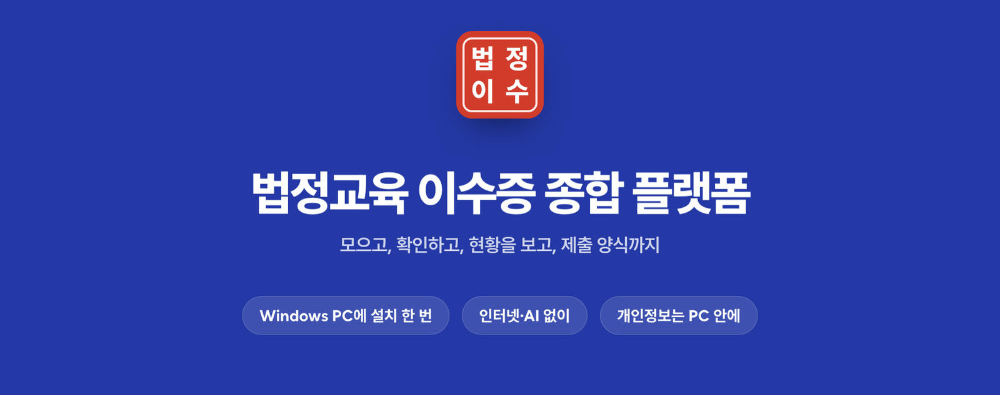
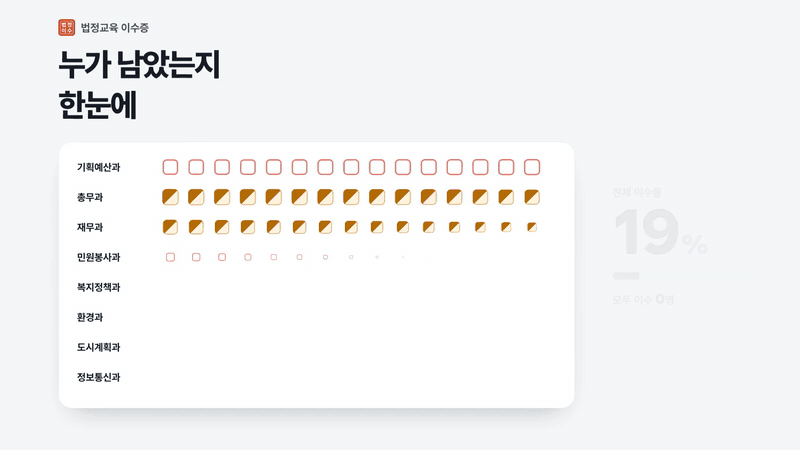
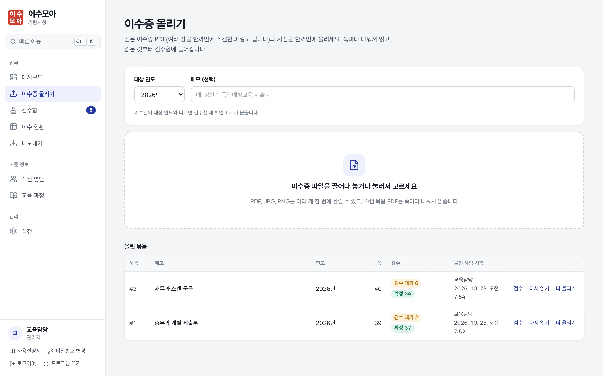
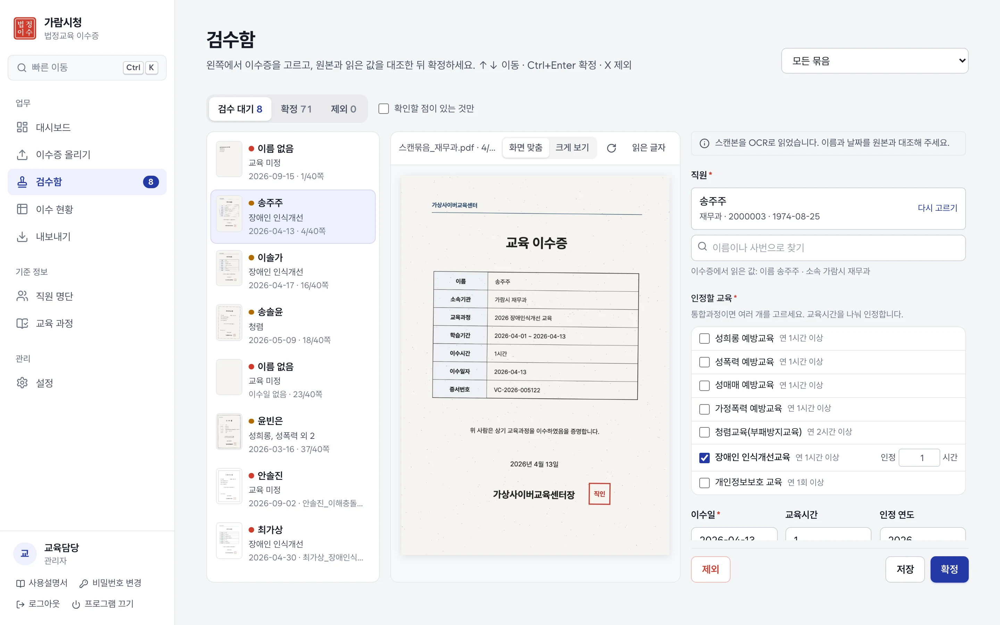
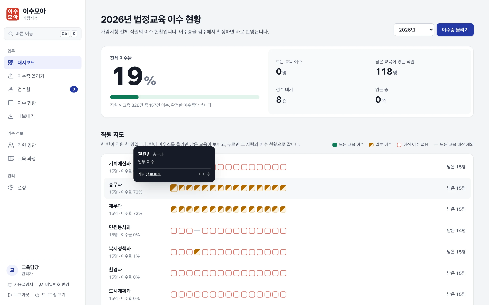
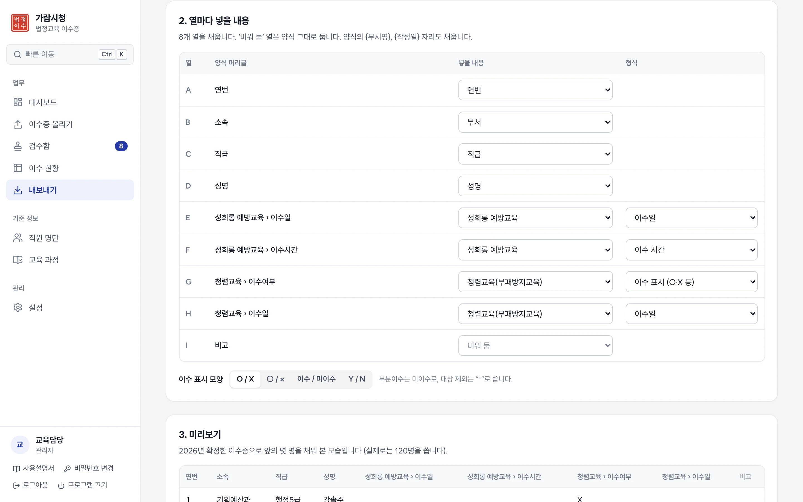
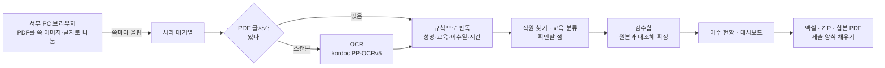

<p align="center">
  
</p>

<p align="center">
  <b>서무가 걷은 법정교육 이수증을 올리면 읽고, 분류하고, 현황을 만들고, 제출 양식까지 채워 주는 프로그램</b><br>
  Windows PC에 설치해 혼자 쓰거나 내부망 서버에 두고 여럿이 씁니다. 이수증은 PC·서버 밖으로 나가지 않습니다.
</p>

<p align="center">
  <a href="docs/사용설명서.md"><b>사용설명서</b></a> ·
  <a href="docs/PC설치안내.md">PC 설치</a> ·
  <a href="docs/설치가이드.md">서버 설치</a> ·
  <a href="docs/운영가이드.md">운영 가이드</a> ·
  <a href="docs/promo/promo.mp4">소개 영상 (49초)</a>
</p>

<p align="center">
  <a href="docs/promo/promo.mp4"></a>
</p>

---

## 무엇이 달라지나

| 지금까지 | 이 프로그램으로 |
|---|---|
| 메일·메신저로 받은 이수증을 하나씩 열어 이름을 바꿔 저장 | 개별 PDF·스캔 묶음·사진을 **한꺼번에 올리면** 쪽마다 나눠 읽음 |
| 이수증을 보며 엑셀 현황표에 한 줄씩 옮겨 적기 | 직원·교육·이수일·시간을 **읽어서 채워 두고**, 원본과 대조해 확정만 |
| 누가 아직 안 들었는지 표를 뒤져 찾기 | **직원 지도**와 미이수자 명단으로 한눈에, 부서별로 바로 |
| 상급기관·부서마다 다른 양식에 다시 옮겨 적기 | 그 **양식을 올려 두면 그대로 채워서** 내보냄 |

## 이렇게 씁니다

<table>
  <tr>
    <td width="50%"></td>
    <td width="50%"></td>
  </tr>
  <tr>
    <td><b>① 올리기</b> — PDF·스캔본·사진을 끌어다 놓습니다. 여러 장을 한 번에 스캔한 PDF도 쪽마다 나눠 읽습니다.</td>
    <td><b>② 검수</b> — 원본과 읽은 값을 나란히 보고 확정합니다. 고칠 점·확인할 점은 색으로 표시하고, 문제없는 것은 한 번에 확정합니다.</td>
  </tr>
  <tr>
    <td></td>
    <td></td>
  </tr>
  <tr>
    <td><b>③ 현황</b> — 한 칸이 직원 한 명인 직원 지도에 마우스를 올리면 남은 교육이 보입니다. 이수 현황 표는 이름·초성으로 찾습니다.</td>
    <td><b>④ 내보내기</b> — 현황 엑셀, 이수증 ZIP, 교육별 합본 PDF, 그리고 부서가 정한 제출 양식에 그대로 채운 엑셀.</td>
  </tr>
</table>

## 특징

- **인터넷·AI 없이** — PDF 글자는 그대로 읽고, 스캔본은 프로그램에 들어 있는 OCR([kordoc](https://www.npmjs.com/package/kordoc), PP-OCRv5 한국어)로 읽습니다. 가상 이수증 79쪽 시험에서 78쪽을 모두 맞게 읽었고, 확인할 점 없이 틀린 쪽은 0쪽이었습니다(스캔본은 쪽당 약 0.4초).
- **틀린 것을 숨기지 않음** — 이름을 명단에서 못 찾았거나, 교육을 못 정했거나, 연도가 다르면 검수함에 표시합니다. 표시 없는 이수증만 일괄 확정할 수 있습니다.
- **제출 양식 그대로** — 빈 엑셀 양식을 올리면 머리글·빈 줄·합계·서명란을 찾고, 사람이 모자라면 줄을 끼우며 합계 수식 범위와 인쇄 영역까지 늘립니다.
- **손에 붙는 화면** — `Ctrl+K` 빠른 이동(초성 검색 `ㄱㅁㅈ`), 검수함 단축키(`↑↓` 이동, `Ctrl+Enter` 확정, `X` 제외), 화면 어디로 끌어도 받는 파일 올리기.
- **공공기관 기준** — 성희롱·성매매·성폭력·가정폭력 예방, 청렴, 장애인 인식개선, 개인정보보호 등 법정교육 기본 목록과 이수 기준(연 n시간·n회)이 들어 있고, 통합과정 이수증은 교육마다 시간을 나눠 인정합니다.
- **기록과 보관** — 감사 로그·접속기록(위·변조 확인), 내려받기 사유, 주민등록번호 뒷자리 가림, 매일 자동 백업과 복원 연습, 보관기간이 지난 자료 파기.

## 두 가지 판

| | PC판 | 서버판 |
|---|---|---|
| 쓰는 곳 | Windows 10·11 PC 한 대 | 내부망 서버(Windows Server·Linux) |
| 쓰는 사람 | 교육 담당자 혼자 | 교육 담당자 + 부서 서무 여럿 (서무는 담당 부서만) |
| 설치 | zip을 풀고 `설치.bat` 두 번 누르기 (관리자 권한 필요 없음) | 압축 풀고 서비스 등록 |
| 안내 | [PC설치안내.md](docs/PC설치안내.md) | [설치가이드.md](docs/설치가이드.md) · [IT-확인요청서.md](docs/IT-확인요청서.md) |

설치본은 `npm run release`로 만듭니다. 실행용 Node.js, 대상 OS용 OCR 엔진, OCR 모델, 글꼴까지 모두 들어 있어 따로 설치할 것이 없습니다.

## 어떻게 돌아가나



## 개발

Node.js 24가 필요합니다.

```bash
npm install
npm run dev
```

화면은 http://localhost:5173, 서버 API는 http://localhost:3000 입니다. 처음 열면 기관명과 관리자 계정을 만듭니다.

| 명령 | 하는 일 |
|---|---|
| `npm run dev` | 화면과 서버를 함께 실행 (코드를 고치면 자동 반영) |
| `npm test` · `npm run typecheck` | 단위·API 테스트 · 타입 검사 |
| `npm run samples` · `samples:certs` · `samples:forms` | 가상 인사 명단 · 가상 이수증(개별 PDF, 40쪽 스캔 묶음, 정답) · 가상 제출 양식 (실존 인물·기관 아님) |
| `npm run eval -- --truth samples/certs/정답.json` | 판독 정확도 점검 (`--truth confirmed`: 확정한 결과를 정답으로, `--engine tesseract`: 대체 OCR로) |
| `npm run restore -- --check` | 백업 복원 연습 (`--list` 목록, `--apply --yes` 실제 복원) |
| `npm run release` | 서버용 설치본 (`-- --target linux-x64 --download-node` 다른 OS용, `-- --target win-x64 --desktop --download-node` PC 설치판) |
| `npm run media:screens` · `media:promo` | 문서용 화면 그림 · 소개 영상 다시 만들기 (헤드리스 크롬, ffmpeg) |

<details>
<summary><b>폴더 구조</b></summary>

```
web/       화면 (React 19, Vite, Tailwind 4)
  src/pages/        화면별 파일 (이수증 올리기, 검수함, 이수 현황, 제출 양식 …)
  src/upload/       브라우저에서 PDF를 쪽 이미지·글자로 나누어 올리기 (pdf.js)
  src/components/   공통 부품 (사이드바, 빠른 이동, 표, 대화상자 …)
server/    서버 (Fastify, Node 내장 SQLite)
  src/routes/       API — 화면이 부르는 주소별 처리
  src/db/           DB 구조(migrations/*.sql), 공공기관 교육 기본 목록
  src/roster/       인사 명단 파일 읽기·비교
  src/certs/        이수증 판독 규칙, 직원 찾기, 교육 분류, 확인할 점, 이수 판정
  src/reports/      이수 현황 계산, 엑셀, 이수증 ZIP·합본 PDF
  src/forms/        제출 양식 읽기(머리글·빈 줄·서명란 찾기)와 채우기(줄 끼우기·수식 범위 고치기)
  src/ocr/          스캔본 글자 읽기 (kordoc, 안 되면 tesseract.js)
  src/ops/          백업, 보관기간·파기, 매일 하는 예약 작업
  src/jobs/         쪽 처리 대기열 (꺼졌다 켜져도 이어서 처리)
  src/auth/         로그인·세션·권한
shared/    화면과 서버가 함께 쓰는 타입과 규칙
scripts/   가상 자료, 판독 정확도 점검, 백업 복원, 설치본, 문서 그림·소개 영상(media/)
deploy/    서비스 등록(Windows 작업 스케줄러, Linux systemd), PC 설치판 스크립트(windows-desktop/)
docs/      사용설명서, 설치·운영 가이드, 정보화 담당 확인 요청서, PC 설치 안내, 그림·소개 영상
vendor/    SheetJS(엑셀 읽기), OCR 모델(PP-OCRv5 한국어)
tests/     단위·API 테스트
```
</details>

<details>
<summary><b>만들어 온 단계</b></summary>

| 단계 | 내용 |
|---|---|
| 1 | 로그인·권한, 부서·서무 계정, 교육 과정, 직원 명단 일괄 등록, 설치본 |
| 2 | 이수증 올리기(PDF 쪽 나누기), 처리 대기열, OCR, 검수함, 이수 판정·현황 |
| 3 | 교육 분류·직원 매칭, 일괄 확정, 정확도 점검 |
| 4 | 대시보드, 엑셀·이수증 ZIP·교육별 합본 PDF, 감사 로그 화면 |
| 5 | 접속기록(위·변조 확인·월 점검), 내려받기 사유, HTTPS, 주민번호 가림, 보관기간·파기, 백업·복원, 서비스 등록 |
| 6 | AI 기능 제거, 스캔본 OCR을 kordoc으로, Windows PC 설치판 |
| 7 | 화면 새 단장(직원 지도, `Ctrl+K`), 제출 양식에 채워 내보내기 |
</details>

<details>
<summary><b>기술을 이렇게 고른 이유</b></summary>

- **내부망 설치** — 설치본에 실행용 Node와 대상 OS용 OCR 엔진(onnxruntime-node, sharp)까지 넣어 복사만 하면 실행됩니다. 대상 OS용이 아닌 네이티브 파일이 섞이면 설치본 만들기가 실패합니다.
- **외부 연결 없음** — 글꼴, PDF 처리 파일, OCR 모델까지 설치본 안에서 제공합니다.
- **OCR은 kordoc** — 같은 가상 이수증으로 비교했을 때 스캔 41쪽 중 tesseract는 37쪽, kordoc은 41쪽을 맞게 읽었습니다.
- **PDF는 서무 PC의 브라우저에서 나눔** — 서버에 그림 라이브러리가 필요 없고, 서버는 OCR과 판독만 합니다.
- **서버 코드는 빌드 없이 실행** — Node의 TypeScript 실행 기능으로 `server/src`를 그대로 실행합니다.
</details>

## 함께 쓰는 공개 소프트웨어

[kordoc](https://www.npmjs.com/package/kordoc)(MIT), PP-OCRv5 모델(Apache-2.0, [vendor/ocr-models/NOTICE.md](vendor/ocr-models/NOTICE.md)), ONNX Runtime(MIT), sharp·libvips(Apache-2.0·LGPL-3.0), tesseract.js(Apache-2.0), [Wanted Sans](https://github.com/wanteddev/wanted-sans)·Noto Serif KR(OFL-1.1), Fastify·React·ExcelJS·pdf-lib(MIT), SheetJS(Apache-2.0).

화면 그림과 소개 영상의 기관·사람·이수증은 모두 가상 자료입니다.
