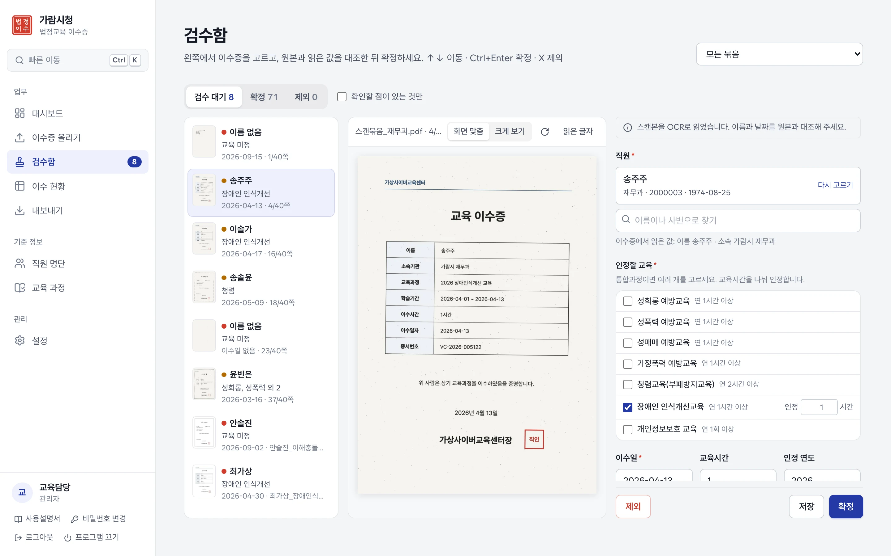

#  이수모아

**법정교육 수료증을 모아 원본과 대조하고, 직원별 이수 현황과 기관 제출 자료를 만드는 Windows 프로그램입니다.**

교육 담당자가 PDF·사진·스캔 묶음을 올리면 설치 PC에서 글자를 읽고 직원·교육·이수일·시간을 후보로 채웁니다. 담당자가 원본을 확인해 확정한 내역으로 현황 엑셀, 교육별 수료자 명단, 증빙 PDF를 만듭니다.

EXE로 설치하며 **Node.js·OCR 구성요소를 따로 설치하지 않습니다.** LLM이 없는 PC에서도 기본 업무를 사용할 수 있습니다.

## Windows 배포판 받기

현재 버전은 **0.5.11**입니다. 일반 사용자는 아래 EXE를 내려받으세요. GitLab에서도 같은 GitHub 다운로드 링크를 사용합니다.

| 파일 | 용도 |
|---|---|
| **[Windows 설치 EXE](https://github.com/MuyeongKim/isumoa-releases/releases/download/v0.5.11/isumoa-setup-0.5.11-win-x64.exe)** | **일반 사용자 권장. 실행해서 설치합니다.** |
| [ZIP 설치판](https://github.com/MuyeongKim/isumoa-releases/releases/download/v0.5.11/isumoa-setup-0.5.11-win-x64.zip) | 압축을 푼 뒤 `설치.bat` 실행 |
| [가상 직원·수료증 모의자료](https://github.com/MuyeongKim/isumoa-releases/releases/download/v0.5.11/demo-samples-0.5.11.zip) | 처음 사용·심사 재현용 직원 120명, 수료증 11개 파일·50쪽 |
| [설치 안내](https://github.com/MuyeongKim/isumoa-releases/releases/download/v0.5.11/PC-install-guide-0.5.11.md) | 설치·자료 위치·업데이트·복원 방법 |
| [검증 결과](https://github.com/MuyeongKim/isumoa-releases/releases/download/v0.5.11/validation-report-0.5.11.md) | 확인한 범위와 Windows 실기기 미확인 항목 |
| [최신 릴리즈·체크섬 전체 보기](https://github.com/MuyeongKim/isumoa-releases/releases/latest) | 변경 사항과 SHA-256 체크섬 |

설치 파일은 **GitHub Releases에만 게시**하며 로그인 없이 받을 수 있습니다. 화면은 설치한 PC의 Edge·Chrome에서 열립니다. 수료증·직원 명단·검수 결과는 해당 PC에 보관됩니다.

## 프로젝트 소개와 개발 경위

- **주제:** 법정교육 이수증 검수와 기관보고 자료 작성의 행정업무 효율화
- **제작자:** 김무영(전북특별자치도 완주소방서)
- **준비 분야:** 2026 공공 AI 대전환 챌린지 세션1, 자유주제
- **결과물:** Windows 설치형 프로그램과 소스코드, 사용 안내, 가상 모의자료

직원이 낸 수료증은 기관마다 서식이 다르고 여러 장이 하나의 스캔 PDF에 섞이기도 합니다. 교육 담당자는 이름·교육·날짜·시간을 옮겨 적고, 직원 명단과 교육 기준을 대조하며, 중복 제출과 잘못된 교육 연결을 다시 확인해야 합니다.

이수모아는 **로컬 AI-OCR → 규칙 대조 → 담당자의 원본 검수 → 현황·보고서 출력**을 하나의 흐름으로 연결했습니다. OCR은 글자를 읽고 규칙은 연결 후보와 확인할 점을 제시합니다. 인정 범위와 최종 확정은 담당자가 결정합니다. 입력 반복과 자료 취합 부담을 줄이는 것이 목적이며, 수작업 대비 시간 절감률은 직원 실측 전까지 제시하지 않습니다.

기관별로 직원·부서·교육 기준·사용자 규칙·제출 양식을 바꿔 사용할 수 있습니다. 현재는 부서 시범운용을 위한 단계이며 전 기관 도입이나 타 부서 독립 사용 실적을 뜻하지 않습니다.

## 주요 기능

| 업무 | 기능 |
|---|---|
| 직원·부서 관리 | 빈 엑셀 양식 다운로드, 직원 일괄 등록, 부서·직원 선택 삭제와 복원 |
| 교육 기준 | 기본 교육 16개, 기관별 연간 시간·횟수 설정, PDF·HWPX·사진에서 읽은 초안 확인·등록 |
| 수료증 등록 | PDF·스캔 묶음·JPG·JPEG·PNG·ZIP 업로드, 쪽별 판독과 중복 확인 |
| 검수함 | 원본·인정 교육·확정 버튼을 함께 배치, 직원·교육명·파일명 검색, 정상 건 일괄 확정, 선택 제외, 이수증 아닌 쪽 일괄 제외·복원 |
| 잘못된 인정 방지 | 교육 주제 충돌과 이미 확정한 동일 수료증의 중복 확정 차단, 일부 폭력예방 주제를 통합 이수로 넘기지 않도록 확인 표시 |
| 현황 | 직원·부서·교육별 이수 현황, 미이수 필터, 오른쪽에 남은 교육 열의 스크롤 안내 |
| 출력 | 교육별 16시트 수료자 명단, 사용자 기관보고 양식, 현황 엑셀, 개인별·교육별 합본 PDF, 개별 수료증 ZIP |
| 파일명 | 개인별 합본 제목과 개별 수료증 ZIP의 공통 파일명 규칙 직접 입력 |
| 검수 규칙 | 공식 서명 규칙 확인·갱신, 사용자 규칙 GUI·JSON 편집, 변경 미리보기·복원 |
| 선택형 로컬 AI | 같은 PC의 Ollama 모델 의견·근거를 보고 선택 반영. 기본 꺼짐, 자동 확정 없음 |
| 유지관리 | 백업·복원, 프로그램·규칙 통합 업데이트, 선택형 자동 확인·알림 |

화면의 기관·직원·수료증은 가상 자료입니다. [소개 영상(49초)](docs/promo/promo.mp4)은 전체 흐름을 보여 주며 최신 변경은 아래 설명과 릴리즈 검증 결과를 참고하세요.

## 실행 환경과 접속 주소

| 항목 | 환경 |
|---|---|
| 운영체제 | Windows 10·11 64비트(x64) |
| 브라우저 | Edge 또는 Chrome |
| 필요 소프트웨어 | 설치 EXE에 Node.js·OCR 엔진·한국어 모델 포함 |
| 디스크 | 설치 시 여유 공간 2GB 이상, 업무 자료·백업에 추가 공간 필요 |
| 연산 | 기본 OCR은 CPU에서 실행. 선택형 LLM의 요구 사양은 설치한 모델에 따름 |
| 접속 | 바탕화면의 이수모아 실행 시 브라우저가 열림. 기본 주소 `http://127.0.0.1:47210` |
| 인터넷 | 배포판·업데이트 다운로드에 필요. 기본 수료증 판독·검수·현황·출력은 로컬에서 수행 |

주소는 PC 내부 접속용입니다. 인터넷 공개 서비스 주소가 아니며 기관 서버로 공동 사용하려면 별도 설치·보안 검토가 필요합니다. 프로그램은 **미서명 시범운용용**이며 기관 정책의 실행 허용 여부는 [PC 설치 안내](docs/사용자/PC설치안내.md)를 확인하세요.

## 설치·실행 절차

1. Windows 설치 EXE를 내려받아 실행합니다. 기관이 허용한 시험 PC에서 시작하세요.
2. 설치 후 바탕화면의 **이수모아**를 엽니다. 처음 실행하면 기관명과 관리자 계정을 직접 만듭니다.
3. **직원 명단 → 일괄 등록 → 빈 양식 다운로드**의 엑셀을 채워 올립니다. 미리보기에서 오류·부서·열 연결을 확인한 뒤 반영합니다.
4. **교육 기준**에서 기본 교육 16개와 연간 기준을 기관 지침에 맞춥니다. 개인정보보호 기본값은 연 1시간이며 기존 사용자 기준을 업데이트로 덮어쓰지 않습니다.
5. **수료증 올리기**에서 PDF·사진 또는 이들을 모은 ZIP을 고릅니다. 읽은 쪽부터 검수함에 들어갑니다.
6. **검수함**에서 원본과 직원·인정 교육·이수일·시간·증서번호를 대조해 확정하거나 제외합니다.
7. **이수 현황**을 확인하고 **내보내기**에서 자료 종류·범위·다운로드 사유를 골라 받습니다.

자료는 `%LOCALAPPDATA%\isumoa`에 보관합니다. 프로그램 제거·업데이트와 자료 보관의 구체적인 동작은 [설치 안내](docs/사용자/PC설치안내.md), 문제 해결은 [운영 가이드](docs/관리자/운영가이드.md)를 참고하세요.

## LLM 연결 설정과 AI 역할

기본 판독은 **kordoc + 한국어 PP-OCRv5**, 대체 판독은 **tesseract.js + 로컬 한국어 데이터**입니다. 모델 파일은 설치판에 포함합니다. OCR이 읽은 글자를 TypeScript 규칙으로 대조하며, 이수모아는 수료증을 모델에 자동 재학습시키지 않습니다.

선택형 추가 검토를 사용할 경우:

1. 같은 PC에서 Ollama와 사용할 로컬 생성 모델을 준비합니다. 이수모아 설치판에 생성형 모델은 포함하지 않습니다.
2. **설정 → 로컬 AI(선택)**에서 기본 주소 `http://127.0.0.1:11434`의 연결 테스트·모델 목록을 누릅니다.
3. 설치된 로컬 생성 모델을 선택하고 사용을 켠 뒤 저장합니다. 다른 설치 모델로 바꿀 때도 이 목록에서 선택합니다. 기본 사용에는 API 키가 필요하지 않습니다.
4. 검수 대기 자료에서 **추가 검토 → AI 추가 검토**를 요청합니다. 현재 값·제안·원문 근거를 보고 반영할 항목만 선택합니다.
5. 편집값에 반영한 뒤 임시 저장·확정 여부를 담당자가 따로 결정합니다.

외부·내부망 주소, 클라우드·원격 별칭, 임베딩 전용 모델은 허용하지 않습니다. 개인정보 가림을 적용한 원문 일부와 판독값을 같은 PC의 모델로 보내며, 값 대응이 불명확한 표는 AI 요청을 보류합니다. 완전한 익명화나 AI 답변의 정확도를 보장하지 않습니다.

**LLM이 없어도 기본 기능을 사용할 수 있습니다.** 기본·대체 OCR을 ‘2종 LLM 구동 입증’으로 계산하지 않으며 실제 2종 LLM 비교는 별도 미확인입니다. [AI·자료 처리](docs/session1/AI-DATA.md), [검수 규칙·로컬 AI 상세](docs/사용자/검수규칙과로컬AI.md)를 참고하세요.

## 모의데이터 안내

[모의자료 ZIP](https://github.com/MuyeongKim/isumoa-releases/releases/download/v0.5.11/demo-samples-0.5.11.zip)을 별도 폴더에 풀어 사용하세요. 모든 인물·기관·수료증은 개발용 합성 자료입니다. 업무 중인 자료와 섞지 말고 새 시험 환경에서 재현하세요.

| 파일 | 용도·투입 방법 |
|---|---|
| `직원명단_2026.xlsx` | 직원 120명·8부서. 직원 명단의 일괄 등록으로 올리고 120명 등록 확인 |
| `이수증/스캔묶음_재무과.pdf` | 40쪽 스캔 묶음. 수료증 올리기에서 선택 |
| `이수증/개별/*.pdf` | 1쪽 PDF 10개. 스캔 묶음과 함께 올리면 11개 파일·50쪽 |
| `정답.json` | 직원·교육·날짜·시간 비교용 개발 정답. 앱에 올리는 파일이 아님 |
| `모의자료_사용안내.md` | 자료 구성·확인 순서·기대 결과 |

소스의 [샘플 정답](samples/certs/정답.json)과 생성 스크립트는 개발용이며, 일반 사용자는 위 ZIP으로 재현할 수 있습니다. 실제 직원 명단·수료증·운영 DB·백업·로그인 정보는 배포 자료에 포함하지 않습니다.

## 기능 사용 순서: 핵심 흐름 3가지

### 1. 모아서 읽고 검수하기

모의 직원 120명을 등록한 뒤 수료증 11개 파일을 올립니다. **검수함에서 ‘폭력예방’으로 검색하면 20건**이 나오며 원본과 네 주제·4시간을 대조합니다. 확인할 점이 없는 자료는 정상 일괄 확정으로 처리합니다. 검색을 초기화해 **이수증 아닌 쪽 2건 한 번에 제외**를 누르면 표지·빈 쪽만 제외됩니다. 다른 정상 자료도 검수·확정하면 예시 결과는 **확정 48건·제외 2건**입니다.

### 2. 중복·주제 충돌 확인하기

확정한 같은 파일을 다시 올리면 중복으로 건너뜁니다. 같은 수료증을 다른 PDF로 재저장해 올리면 증서번호·직원·기관·날짜 등을 비교하고, 이미 확정된 동일 수료증은 재확정을 차단합니다. 교육 주제 충돌도 인정 교육 또는 과정명을 올바르게 고친 뒤에만 확정할 수 있습니다. 경고가 있는 자료를 정상 자료에 섞어 자동 확정하지 않습니다.

### 3. 현황에서 보고서·증빙 받기

**이수 현황**에서 부서·연도·미이수 필터를 사용하고 칸을 눌러 근거 수료증을 봅니다. 오른쪽에 열이 더 있으면 가로 스크롤 안내가 나타납니다. **내보내기 → 수료자 명단(16시트)**에서 범위와 사유를 선택해 엑셀을 받습니다. 기준 미충족이나 검수 대기가 있어도 현재 확정 내역을 받을 수 있으며, 대기·제외 건은 포함하지 않습니다. 개인별 합본 PDF와 개별 수료증 ZIP은 제목·파일명 규칙을 입력해 받을 수 있습니다.

기관보고 양식은 일반 `.xlsx`로 올립니다. 2026년 기본 양식의 현원은 빈칸으로 두고, 부분이수는 비고에 표시하며 이수 인원은 해당 교육 기준을 충족한 직원만 셉니다. 기관별 인정 대상·기준은 담당자가 확인해야 합니다.

## 0.5.11 변경과 검증

- 4대 폭력 전체 범위가 명시된 과정은 확실한 연결로 처리합니다. 연도·띄어쓰기·문장부호·전각 숫자·‘사대폭력’ 표기를 보완했습니다. 2~3개 주제, 일부·제외·선택·택1은 확인 표시를 유지합니다.
- 기존 대기의 정확한 통합 연결에 남은 이름 비교·전체 범위 경고는 읽을 때 재평가합니다. 저장된 수정값과 확정·제외 기록은 자동 변경하지 않습니다.
- 현재 검색 결과의 이수증 아닌 쪽을 한 번에 제외하고 복원할 수 있습니다. 서버가 권한·대기 상태·현재 경고를 다시 검사하며 확인창 뒤 자료가 바뀌면 처리를 중단합니다.
- 현황 표에 가로 스크롤 안내와 그림자를 추가했습니다. 샘플 정답·생성기·평가 스크립트를 현재 교육 코드·설치 규칙과 맞췄습니다.
- 기존 프로그램·공식 규칙 통합 업데이트, 기본 꺼짐인 자동 확인·알림, 사용자 규칙·선택형 로컬 AI 기능을 유지합니다.

**자동 테스트 587개(52개 파일), 타입 검사, 보안 회귀 43개를 통과했습니다.** 같은 가상 자료 50쪽 평가에서 직원·이수일·교육·시간 각각 48/48, 이수증 아님 2/2, 모두 맞은 쪽 50/50·표시 없는 오인식 0쪽입니다. 이 결과는 합성 표본 회귀 검증이며 실제 모든 기관 서식의 정확도를 뜻하지 않습니다.

실제 UI의 120명 등록·50쪽 검수·일괄 확정·일괄 제외·1366×800 가로 안내·엑셀 다운로드·중복 확정 차단을 확인했습니다. [사용성 검증](docs/검증기록/검수함-사용성-개선-검증-2026-11-01.md), [과정명 경계 검증](docs/검증기록/폭력예방-과정명-후속-검증-2026-11-01.md), [릴리즈 검증 결과](https://github.com/MuyeongKim/isumoa-releases/releases/download/v0.5.11/validation-report-0.5.11.md)를 참고하세요.

## 알려진 제약·개인정보·라이선스

- **Windows 실기기 설치·업데이트, Windows Excel/한셀 열기·인쇄, 기관 백신 검사는 미확인**입니다. 사용자 확인 후 부서 시범운용 범위를 넓힙니다. [Windows 확인표](docs/session1/WINDOWS.md)
- 스캔·사진은 기울기·화질·서식에 따라 잘못 읽을 수 있어 원본 대조가 필요합니다. 불명확한 시간·교육·직원은 담당자가 확인합니다.
- DB·원본·백업은 앱 자체에서 자동 암호화하지 않습니다. PC 계정·디스크·폴더 접근 권한으로 보호하고 백업은 별도 디스크에도 보관하세요.
- 업데이트 확인·다운로드에는 GitHub 통신이 필요합니다. 자동 확인은 선택형·기본 꺼짐이며, 업무 자료를 요청에 담지 않습니다. 자동 다운로드·설치·규칙 적용은 하지 않습니다.
- 현재 기관·직원·교육 기준·사용자 규칙은 업데이트 시 보존합니다. 설치 전 **설정 → 백업·보관 → 지금 백업**을 확인하세요. 0.4.3 이하 설치판은 최신 EXE를 직접 실행해 업데이트합니다.
- 오픈소스·모델·글꼴 고지는 설치판에 포함합니다. [라이선스 안내](docs/licenses/README.md), [모델 출처·해시](vendor/ocr-models/NOTICE.md)를 참고하세요. 프로그램은 EXE 코드 서명이 없는 배포판입니다.

## 공모 제출 항목과 문서

[행정안전부 참가 안내](https://www.mois.go.kr/frt/bbs/type013/commonSelectBoardArticle.do?bbsId=BBSMSTR_000000000006&nttId=130237)의 README 요구사항(접속 주소·주요 기능·실행 방법)과 양식 2-1 구동안내서의 실행 환경·설치 절차·LLM 설정·모의데이터·사용 순서·제약·개발 경위를 이 문서에 정리했습니다. 최종 PDF 구동안내서·참가신청·동의·서명·제출본 고정은 [세션1 제출 준비](docs/session1/README.md)에 따라 별도로 진행합니다.

- [사용설명서](docs/사용자/사용설명서.md) · [PC 설치 안내](docs/사용자/PC설치안내.md) · [운영 가이드](docs/관리자/운영가이드.md)
- [통합 업데이트·자동 확인](docs/사용자/업데이트안내.md) · [규칙 커스텀·로컬 AI](docs/사용자/검수규칙과로컬AI.md)
- [부서 직원 실측 절차](docs/session1/PILOT.md) · [AI·자료 처리](docs/session1/AI-DATA.md)
- [개발 안내](docs/개발/개발안내.md) · [서버 설치](docs/관리자/설치가이드.md) · [정보화 담당 확인](docs/관리자/IT-확인요청서.md)

일반 사용자 배포판은 GitHub Releases에서 관리합니다. 심사용 공공 GitLab 프로젝트에는 최종 소스·실행 안내를 고정하며, 정식 제출 여부와 공개 배포 여부를 구분합니다.
