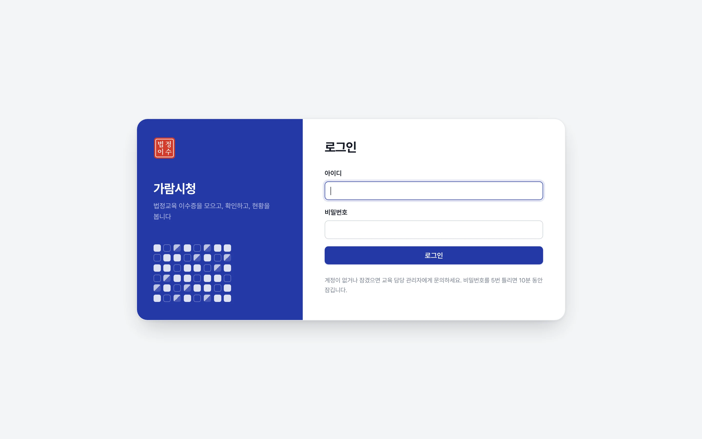
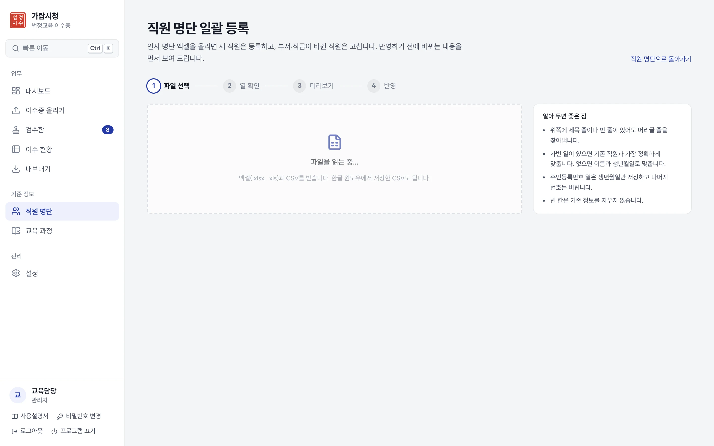
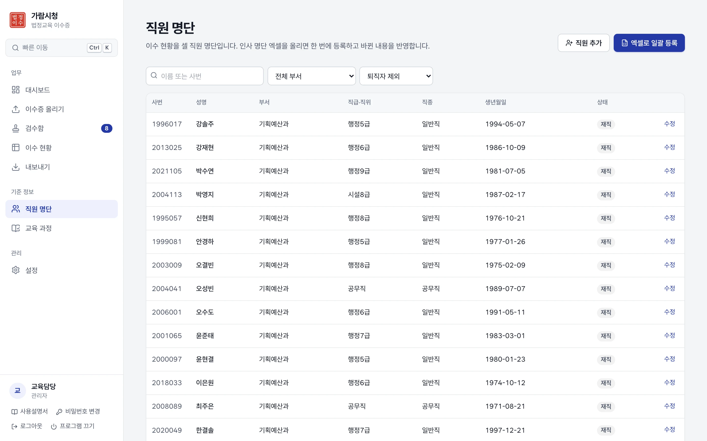
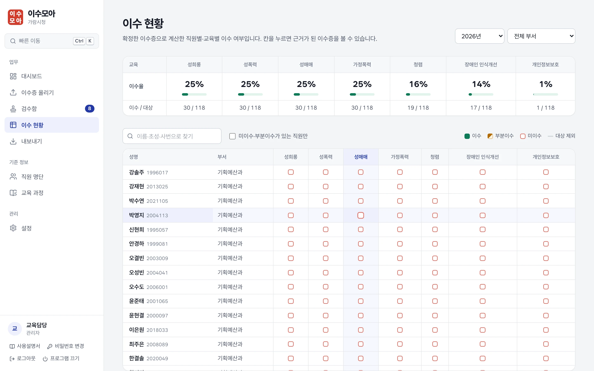
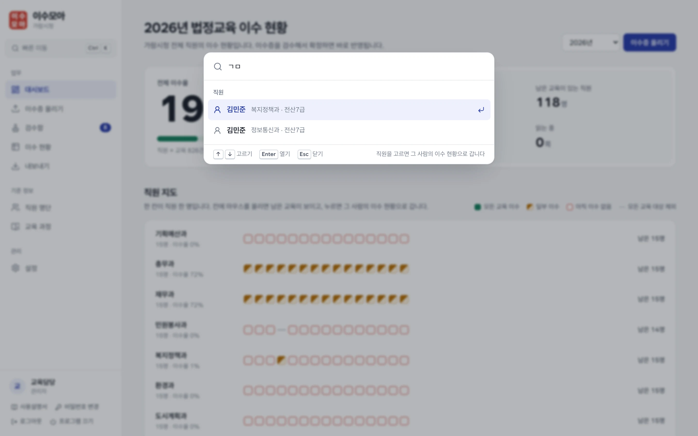
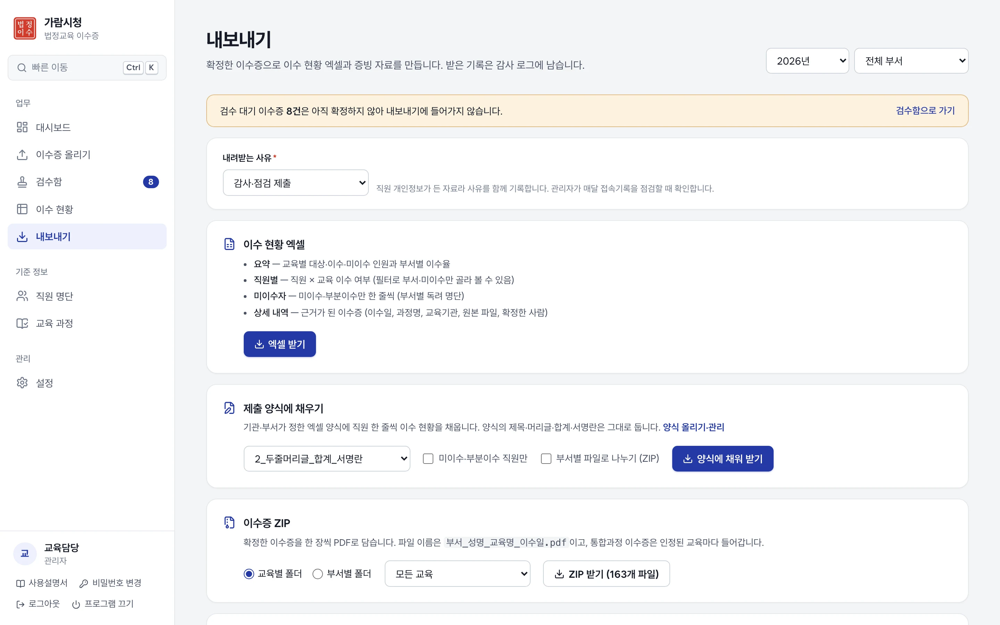
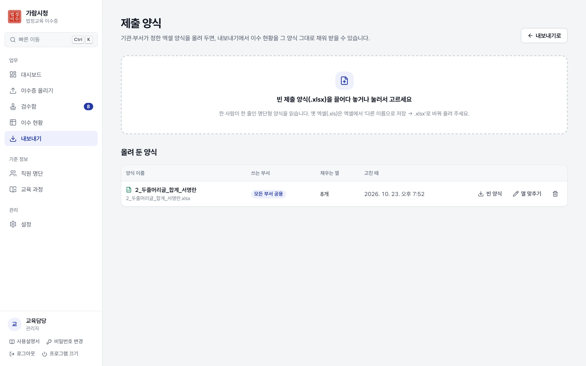
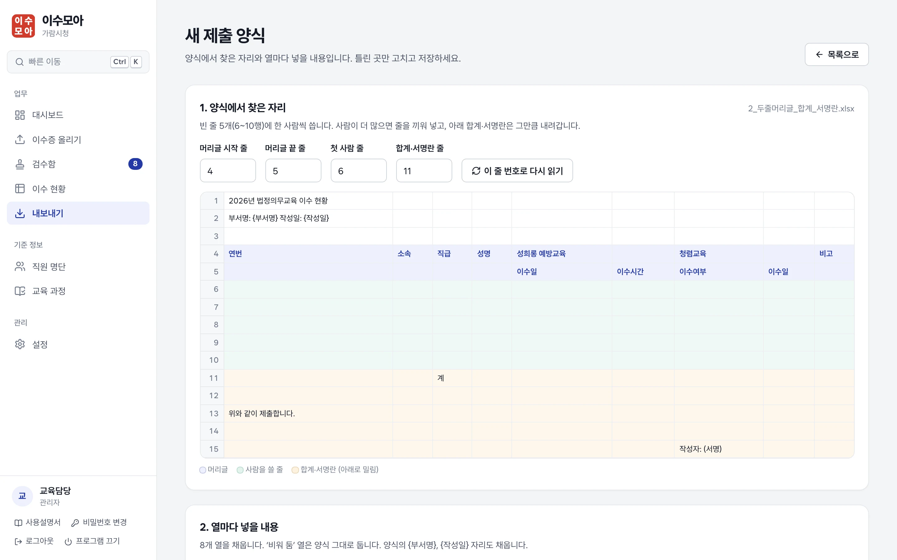
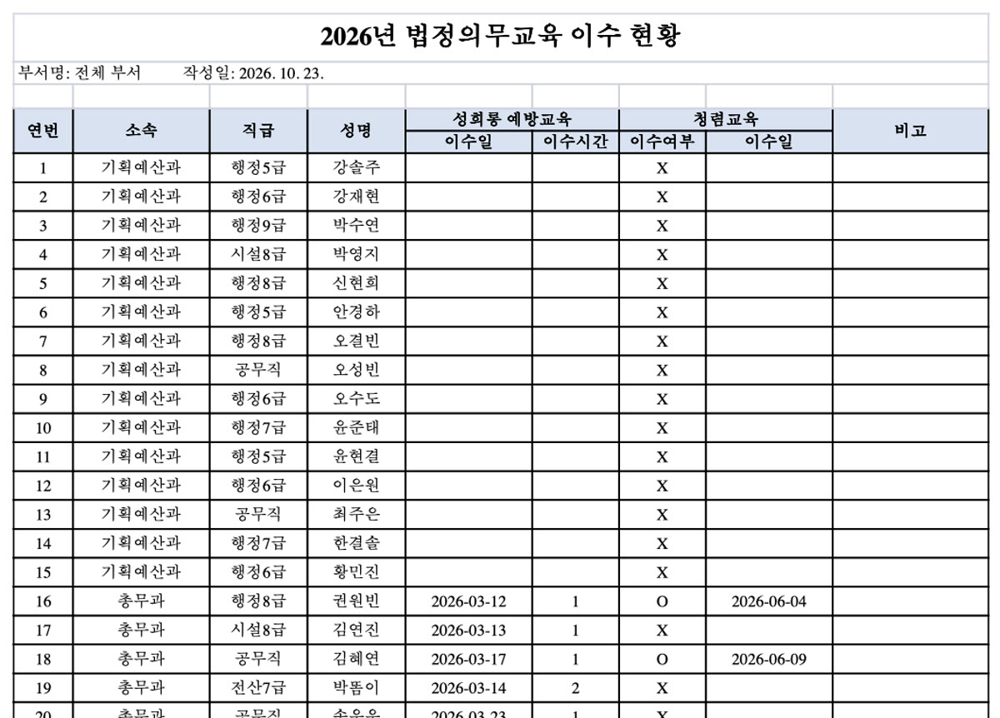

# 이수모아 사용설명서

> 교육 담당자와 부서 서무를 위한 안내입니다. 버전 0.3 기준. 그림 속 기관·사람은 모두 가상입니다.

**이수모아**는 법정교육 이수증을 모으고, 확인하고, 이수 현황을 보고, 제출 양식까지 채우는 일을 한곳에서 합니다. 처음이라면 [처음 시작하기](#1-처음-시작하기)부터 차례로 읽고, 익숙해지면 필요한 부분만 찾아 보세요.

**한 해의 흐름**

1. 연초: 인사 명단으로 직원을 등록하고 교육 과정 기준을 확인합니다.
2. 수시로: 걷은 이수증을 올리고, 검수함에서 확인해 확정합니다.
3. 수시로: 대시보드와 이수 현황에서 남은 사람을 찾아 독려합니다.
4. 제출 때: 현황 엑셀이나 제출 양식에 채운 파일을 받아 냅니다.

---

## 1. 처음 시작하기

### 1-1. 프로그램 열기

- **PC판**: 바탕화면의 **이수모아** 아이콘을 누르면 브라우저에 화면이 열립니다. 설치 방법은 [PC 설치 안내](PC설치안내.md)를 보세요.
- **서버판**: 정보화 담당에게 받은 주소(예: `https://edu-cert.기관.go.kr`)를 Edge나 Chrome으로 엽니다.

### 1-2. 처음 설정과 로그인

처음 열면 **기관명**과 **관리자 계정**(교육 담당자)을 만드는 화면이 나옵니다. 그다음부터는 아이디와 비밀번호로 로그인합니다.

- 비밀번호는 영문 대·소문자·숫자·특수문자 중 2가지 이상이면 10자 이상, 3가지 이상이면 8자 이상이어야 합니다.
- 5번 틀리면 10분 동안 잠깁니다. 관리자가 **설정 > 사용자 계정**에서 비밀번호를 초기화하면 바로 풀립니다.
- 60분 동안 쓰지 않으면 저절로 로그아웃됩니다.

### 1-3. 시작 준비

관리자로 처음 로그인하면 대시보드 아래에 **시작 준비** 목록이 나옵니다. 위에서부터 차례로 하면 됩니다.

| 순서 | 할 일 | 어디서 |
|---|---|---|
| 1 | 기관 정보 확인 | 설정 > 기관 정보 |
| 2 | 인사 명단으로 직원 등록 | 직원 명단 > 엑셀로 일괄 등록 ([2장](#2-직원-명단-등록)) |
| 3 | 부서별 서무 계정 만들기 (서버판) | 설정 > 사용자 계정 ([3장](#3-교육-과정과-계정)) |
| 4 | 교육 과정 기준 확인 | 교육 과정 ([3장](#3-교육-과정과-계정)) |

---

## 2. 직원 명단 등록

이수율은 **등록된 직원**을 기준으로 계산합니다. 인사 시스템에서 받은 명단 엑셀(xlsx·xls·csv)을 그대로 올리면 됩니다.

1. **직원 명단 > 엑셀로 일괄 등록**에서 파일을 고릅니다.
2. **열 확인**: 프로그램이 머리글(사번·성명·소속·직급…)을 찾아 열을 맞춰 둡니다. 다르면 고릅니다.
3. **미리보기**: 새로 등록, 바뀜(부서 이동·승진), 같음, 오류로 나눠 보여 줍니다.
4. **반영**하면 끝납니다.

- 주민등록번호 열이 있어도 **생년월일만** 저장하고 나머지 번호는 저장하지 않습니다.
- 사람이 바뀔 때마다 새 명단을 다시 올리면 바뀐 사람만 고칩니다. 명단에서 빠진 사람을 퇴직으로 바꿀지도 고를 수 있습니다.
- 한두 명은 **직원 명단 > 직원 추가**로 직접 넣어도 됩니다.

---

## 3. 교육 과정과 계정

### 교육 과정

**교육 과정** 화면에 공공기관 법정교육 기본 목록이 들어 있습니다(성희롱·성매매·성폭력·가정폭력 예방, 청렴, 장애인 인식개선, 개인정보보호 등).

- 교육마다 **이수 기준**(연 n시간 이상 또는 연 n회 이상)과 **찾을 단어**가 있습니다. 이수증의 과정명에 찾을 단어가 있으면 그 교육으로 분류합니다. 예: "공직자 반부패 교육" → 청렴교육(찾을 단어 '반부패').
- 기관 지침과 다르면 고치고, 기관에서 따로 정한 교육은 추가합니다. 쓰지 않는 교육은 끕니다.

### 서무 계정 (서버판)

**설정 > 사용자 계정**에서 부서 서무 계정을 만들고 **담당 부서**를 정합니다. 서무는 담당 부서 직원과 이수증만 보고 내보낼 수 있습니다. 처음 로그인하면 비밀번호를 바꾸게 되어 있습니다.

---

## 4. 이수증 올리기

1. **대상 연도**를 고르고, 필요하면 **메모**(예: "상반기 폭력예방교육 제출분")를 적습니다.
2. 이수증 파일을 끌어다 놓거나 눌러서 고릅니다. 화면 어디로 끌어와도 받습니다.
   - PDF, JPG, PNG를 여러 개 한 번에 올릴 수 있습니다.
   - 여러 장을 한꺼번에 스캔한 PDF는 **쪽마다 나눠서** 한 장씩 읽습니다.
3. 올린 쪽은 차례로 읽고, **다 읽은 것부터 검수함에 들어갑니다.** 다른 화면으로 가도 계속 처리합니다.

알아 두면 좋은 것:

- 같은 파일을 다시 올리면 "이미 올린 파일"로 건너뜁니다.
- 글자가 든 PDF는 글자를 그대로 읽고, 스캔본·사진은 프로그램 안의 OCR로 읽습니다. **이수증은 인터넷이나 AI로 보내지 않습니다.**
- 이수일이 대상 연도와 다르면 검수할 때 확인 표시가 붙습니다.
- **올린 묶음** 목록에서 그 묶음만 검수하거나, 다시 읽거나, 이어서 더 올릴 수 있습니다.

---

## 5. 검수하기

검수함에서 원본과 읽은 값을 대조하고 **확정**합니다. 확정해야 이수 현황에 들어갑니다.

화면은 세 부분입니다: 왼쪽 **이수증 목록**, 가운데 **원본**, 오른쪽 **읽은 값**.

1. 목록에서 이수증을 고릅니다. 이름 옆 점의 색이 상태입니다.
2. 오른쪽 위의 표시를 봅니다.

   | 색 | 뜻 | 할 일 |
   |---|---|---|
   | 빨강 | 고칠 점 (직원을 못 찾음, 교육을 못 정함 등) | 직원이나 교육을 골라야 확정할 수 있습니다 |
   | 주황 | 확인할 점 (연도가 다름, 이수증이 아닌 쪽 같음 등) | 원본을 보고 맞으면 확정, 아니면 제외 |
   | 파랑 | 안내 (스캔본은 이름·날짜를 원본과 대조하세요) | 한 번 대조합니다 |

3. **직원**: 명단에서 찾은 사람이 맞는지 봅니다. 다르면 이름이나 사번으로 찾아 고릅니다.
4. **인정할 교육**: 통합과정 이수증이면 여러 교육을 고릅니다. 교육시간을 나눠 인정합니다.
5. **이수일·교육시간·인정 연도**를 확인하고 **확정**합니다. 이수증이 아니면(표지, 빈 쪽) **제외**합니다.

| 단축키 | 하는 일 |
|---|---|
| `↑` `↓` (또는 `K` `J`) | 이전·다음 이수증 |
| `Ctrl` + `Enter` | 확정 |
| `X` | 제외 |

- 고칠 점·확인할 점이 하나도 없는 이수증은 **정상 n건 일괄 확정**으로 한 번에 확정할 수 있습니다.
- 확정한 뒤에도 **확정** 탭에서 고르고 **검수 대기로 되돌리기**로 다시 고칠 수 있습니다.
- 원본은 **화면 맞춤 / 크게 보기**, 90° 돌리기, **읽은 글자** 보기를 할 수 있습니다.

---

## 6. 현황 보기

### 대시보드

- **전체 이수율**: 직원 × 교육 칸 가운데 이수한 비율입니다. 확정한 이수증만 셉니다.
- 오른쪽 숫자(모든 교육 이수, 남은 교육이 있는 직원, 검수 대기, 읽는 중)를 누르면 그 화면으로 갑니다.
- **직원 지도**: 한 칸이 직원 한 명입니다. 마우스를 올리면 남은 교육이 보이고, 누르면 그 사람의 이수 현황으로 갑니다.

| 칸 모양 | 뜻 |
|---|---|
| 꽉 찬 초록 | 모든 교육 이수 |
| 반쯤 찬 주황 | 일부 이수 (시간이 모자라거나 아직 안 들은 교육이 있음) |
| 빨간 테두리 | 아직 이수한 교육이 없음 |
| 가는 회색 줄 | 모든 교육이 대상 제외 (휴직·파견 등) |

### 이수 현황

- 직원 × 교육 표입니다. 위쪽에 교육별 이수율, 아래에 직원별 칸이 있습니다.
- **이름·초성·사번으로 찾기**: `김민준`, `ㄱㅁㅈ`, `2014` 모두 됩니다.
- **미이수·부분이수가 있는 직원만**을 켜면 독려할 사람만 남습니다.
- 칸을 누르면 그 판정의 근거가 된 이수증을 볼 수 있습니다.
- 휴직·파견 중이거나 그 교육의 대상이 아닌 직원은 **대상 제외**로 표시하고 이수율 계산에서 뺍니다.

### 빠른 이동 (`Ctrl` + `K`)

어느 화면에서든 `Ctrl` + `K`를 누르면 빠른 이동 창이 열립니다. 메뉴 이름이나 **직원 이름**을 입력하고 `Enter`를 누르면 바로 갑니다. 이름은 초성(`ㄱㅁㅈ`)으로도 찾고, 직원을 고르면 그 사람의 이수 현황으로 갑니다.

---

## 7. 내보내기

**내보내기**에서 연도와 부서를 고르고, 먼저 **내려받는 사유**를 고릅니다. 직원 개인정보가 든 자료라서 사유를 함께 기록하고, 관리자가 매달 접속기록을 점검할 때 확인합니다.

| 자료 | 내용 |
|---|---|
| 이수 현황 엑셀 | 요약(교육별·부서별 이수율), 직원별, 미이수자, 상세 내역(근거 이수증) 4개 시트 |
| 제출 양식에 채우기 | 올려 둔 엑셀 양식에 그대로 채움 ([8장](#8-제출-양식에-채우기)) |
| 이수증 ZIP | 교육별 또는 부서별 폴더에 `부서_성명_교육명_이수일.pdf` |
| 교육별 합본 PDF | 교육 하나의 이수증을 부서·성명 순서로 한 파일에 |

- 확정한 이수증만 들어갑니다. 검수 대기가 남아 있으면 화면 위쪽에 알려 줍니다.
- 서무는 담당 부서 것만 받습니다.

---

## 8. 제출 양식에 채우기

상급기관이나 부서에 내는 엑셀 양식이 따로 있으면, 빈 양식을 한 번 올려 두세요. 그다음부터는 그 양식 그대로 채워진 파일을 받습니다.

### 8-1. 양식 올리기

**내보내기 > 양식 올리기·관리**(또는 `Ctrl` + `K` → "제출 양식")에서 빈 양식(.xlsx)을 올립니다.

### 8-2. 찾은 자리 확인

프로그램이 양식에서 세 곳을 찾아 색으로 보여 줍니다.

- **파랑**: 머리글 줄 (성명·소속 같은 칸 이름. 두 줄로 합친 머리글도 읽습니다)
- **초록**: 사람을 한 줄씩 쓸 빈 줄
- **주황**: 합계·서명란 (사람이 늘면 그만큼 아래로 내려갑니다)

틀렸으면 줄 번호를 고치고 **이 줄 번호로 다시 읽기**를 누릅니다.

### 8-3. 열마다 넣을 내용

열마다 무엇을 넣을지 프로그램이 골라 둡니다. 틀린 열만 고르면 됩니다.

- 사람: 연번, 성명, 부서, 직급, 사번, 생년월일, 직종, 아직 이수하지 않은 교육(비고 칸용)
- 교육: 이수 표시(O·X 등), 이수 상태, 이수일, 이수 시간, 과정명, 교육기관
- **이수 표시 모양**은 O/X, ○/×, 이수/미이수, Y/N 중에서 고릅니다. 부분이수는 미이수로, 대상 제외는 "-"로 씁니다.

아래 **미리보기**에 앞의 몇 명이 채워진 모습이 나옵니다. 양식 이름과 **쓰는 부서**(관리자는 "모든 부서 공용"도 가능)를 정해 **양식 저장**을 누릅니다.

### 8-4. 받기

**내보내기**의 **제출 양식에 채우기**에서 양식을 고르고 **양식에 채워 받기**를 누릅니다.

- **미이수·부분이수 직원만**: 독려 명단을 양식으로 낼 때.
- **부서별 파일로 나누기 (ZIP)**: 전체 부서를 고른 경우 부서마다 파일을 따로 만듭니다.
- 양식에 `{기관명}` `{부서명}` `{연도}` `{작성일}` `{작성자}`라고 적어 두면 그 자리를 채웁니다.
- 합계 수식이 있으면 끼운 줄까지 범위를 늘리고, 엑셀이 열 때 다시 계산합니다.

**읽지 못하는 양식**

- 옛 엑셀(.xls): 엑셀에서 **다른 이름으로 저장**을 누르고 파일 형식을 **Excel 통합 문서**(.xlsx)로 바꿔 올리세요.
- 한글(.hwp) 양식, 한 사람이 여러 줄을 쓰는 양식, 한 시트에 표가 여럿인 양식은 아직 지원하지 않습니다.
- 그림·글상자가 있거나 다른 시트를 가리키는 수식이 있으면 저장할 때 주의 표시가 나옵니다. 받은 파일을 한 번 열어 보고 내세요.

---

## 9. 백업과 보관 (관리자)

**설정 > 백업·보관**에서 합니다.

- **자동 백업**: 하루에 한 번 DB 사본을 만들고, 원본 파일·쪽 이미지는 바뀐 것만 복사합니다. PC판은 그날 처음 켰을 때 `문서\이수모아 백업`에 만듭니다. **지금 백업**으로 바로 만들 수도 있습니다.
- 백업이 PC 안에만 있으면 PC가 고장 날 때 함께 잃습니다. 가끔 백업 폴더를 USB나 부서 공유 폴더에 복사해 두세요.
- **보관기간**: 이수증 자료(기본 5년), 접속기록(2년), 감사 로그(3년), DB 백업본 개수를 정합니다.
- **파기**: 보관기간이 지난 연도는 확인한 뒤 파기합니다. 되돌릴 수 없으니 필요하면 먼저 현황 엑셀을 받아 두세요. 파기 내역은 감사 로그에 남습니다.

그 밖의 설정 탭: **부서**, **사용자 계정**, **기관 정보**, **감사 로그**, **접속기록**(월 1회 점검 기록), **시스템 점검**(고칠 점 알림).

---

## 10. 프로그램 끄기 (PC판)

왼쪽 아래 **프로그램 끄기**를 누릅니다. 처리 중인 이수증이 있으면 마친 뒤 꺼집니다. 브라우저 창만 닫으면 프로그램은 뒤에서 켜져 있고, 아이콘을 다시 누르면 바로 열립니다.

---

## 11. 자주 묻는 질문

**이수증을 올렸는데 검수함에 안 보여요.**
아직 읽는 중일 수 있습니다. 화면 위쪽의 "읽는 중" 안내와 대시보드의 **읽는 중** 숫자를 보세요. 세 번 시도해도 못 읽은 쪽은 올린 묶음 목록에 표시됩니다.

**이름을 다르게 읽었어요.**
스캔 상태가 나쁘면 비슷한 글자로 읽을 수 있습니다. 검수함의 **직원**에서 이름이나 사번으로 찾아 고르면 됩니다. 명단에 없는 이름이면 빨강 표시가 붙어 그대로 확정되지 않습니다.

**4대폭력 통합교육처럼 여러 교육을 한 번에 들었어요.**
인정할 교육에서 해당 교육을 모두 고르면 교육시간을 나눠 인정합니다.

**이수율 숫자가 생각보다 낮아요.**
**확정한 이수증만** 셉니다. 검수 대기가 남아 있는지 보세요. 휴직·파견 중인 직원은 대상에서 빠집니다.

**같은 사람이 같은 교육을 두 번 들었어요.**
둘 다 확정해도 됩니다. 시간 기준 교육은 시간을 더해서 판정합니다.

**비밀번호를 잊었어요.**
다른 관리자에게 **설정 > 사용자 계정 > 비밀번호 초기화**를 부탁하세요. 관리자가 한 명뿐이면 되찾을 수 없으니 관리자 계정을 둘 만들어 두기를 권합니다.

**제출 양식에서 열을 잘못 찾았어요.**
**제출 양식** 목록에서 **열 맞추기**를 눌러 언제든 고칠 수 있습니다.

---

문의: 교육 담당 관리자 · 설치·서버 문제는 [설치가이드](설치가이드.md) / [PC설치안내](PC설치안내.md)의 "문제가 생겼을 때"를 보세요.
